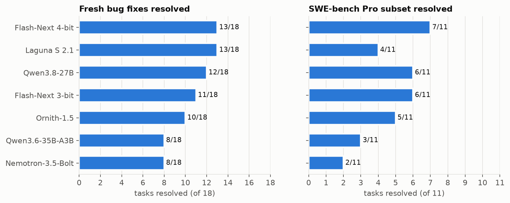
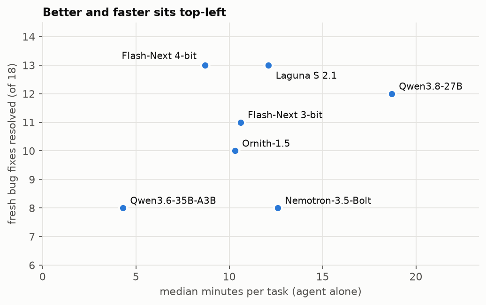
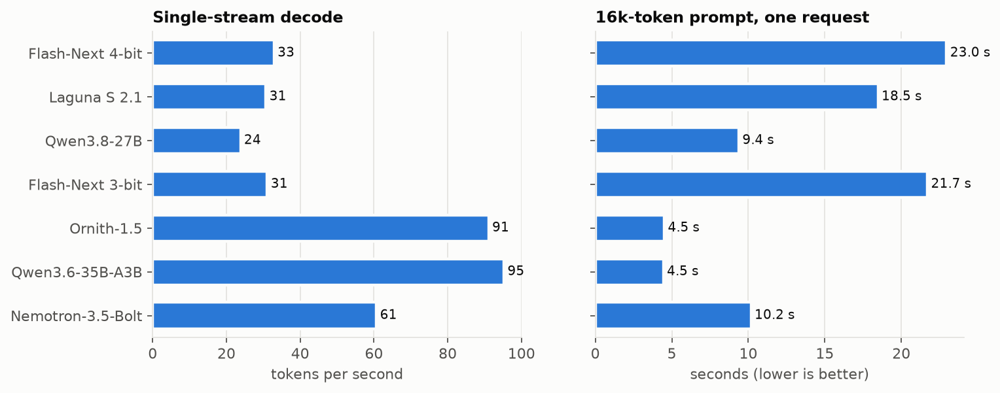
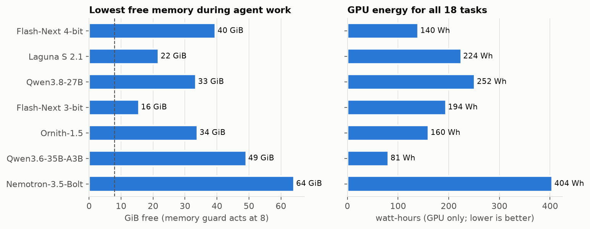
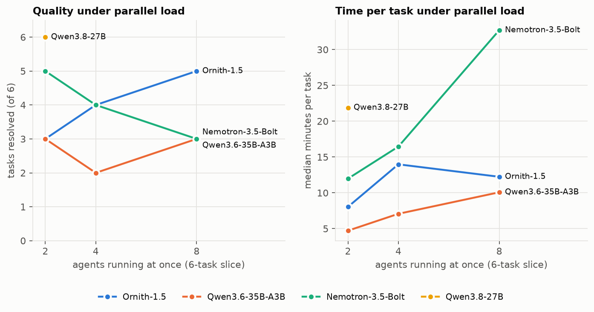
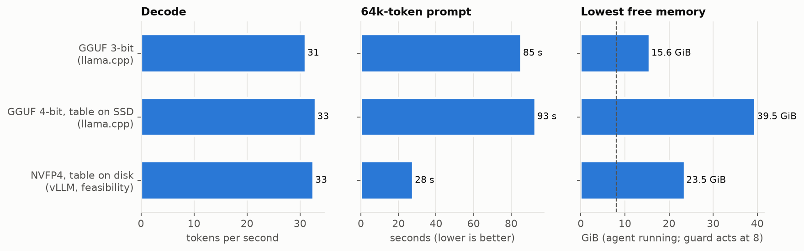
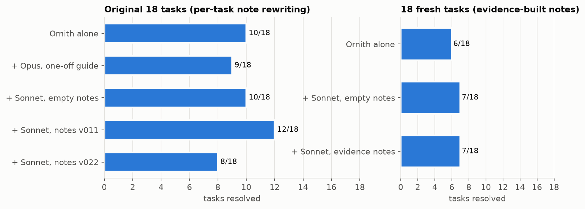
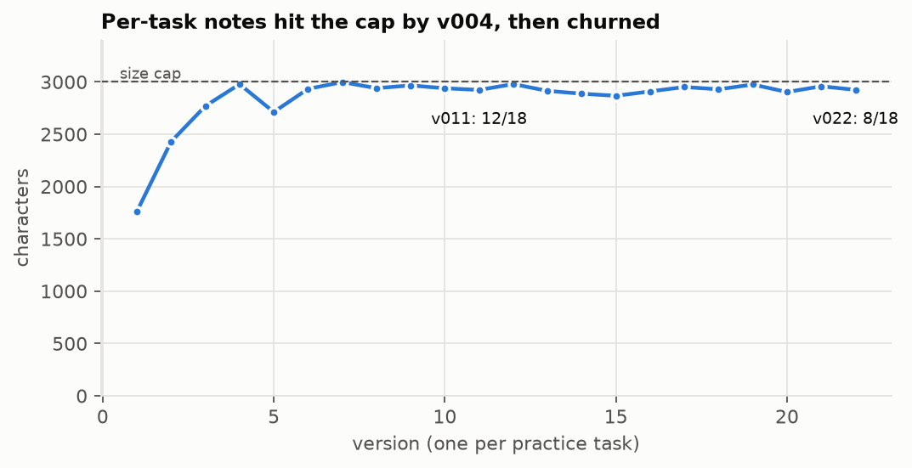

# Local coding agents on a DGX Spark-class box: study report

Generated by `bench/make_report.py` from the data in this repository; method in [METHOD.md](../METHOD.md),
every number per run in [RESULTS.md](../RESULTS.md) and `data/`. One ASUS Ascent GX10 (NVIDIA GB10, 128 GB unified
memory). The agent is Claude Code, headless, in a network-isolated microVM, on the model server. Grading is by
hidden tests. Single attempts per task unless noted: with 18 or 11 tasks, one or two tasks either way is noise.

## Headline

- **Best quality: Qwen3.8-Flash-Next at 4 bits** (13/18, SWE-bench Pro 7/11). The 4th bit only fit after its
  n-gram table moved to SSD. It is also fast per task (8.7 min) and frugal (140 Wh for 18 tasks).
- **Laguna S 2.1 ties it on our bug fixes (13/18)** but is mid-pack on SWE-bench Pro (4/11). Ollama and
  llama.cpp ran it at the same speed.
- **Fast and light: Ornith-1.5 / Qwen3.6-35B-A3B** (91–95 tok/s, 40+ GiB free with 8 agents). Ornith, a fine-tune
  of Qwen3.6, solves more (10 vs 8) by reasoning more: about 3× the output tokens per task.
- **A Claude planner does not add quality here, but it does save time.** Ornith with Sonnet planning and reviewing
  solved 7/18 fresh tasks against 6/18 alone, with a 40–50% shorter median time per task. Notes that Claude rewrote
  after every task churned and ended worse. Notes rebuilt from evidence did no harm, but showed no clear gain.

## Models

| Model | Engine | Fresh-PR (18) | SWE-bench Pro (11) | Median min/task | Decode tok/s | 16k prompt (s) | Min free GiB | GPU Wh (18) |
|---|---|---|---|---|---|---|---|---|
| Flash-Next 4-bit | llama.cpp | 13 | 7 | 8.7 | 33 | 23.0 | 40 | 140 |
| Laguna S 2.1 | ollama | 13 | 4 | 12.1 | 31 | 18.5 | 22 | 224 |
| Qwen3.8-27B | vllm | 12 | 6 | 18.7 | 24 | 9.4 | 33 | 252 |
| Flash-Next 3-bit | llama.cpp | 11 | 6 | 10.6 | 31 | 21.7 | 16 | 194 |
| Ornith-1.5 | vllm | 10 | 5 | 10.3 | 91 | 4.5 | 34 | 160 |
| Qwen3.6-35B-A3B | vllm | 8 | 3 | 4.3 | 95 | 4.5 | 49 | 81 |
| Nemotron-3.5-Bolt | vllm | 8 | 2 | 12.6 | 61 | 10.2 | 64 | 404 |

## Speed, memory and energy

Prompt processing, not decode, separates the models in agent work: every turn re-sends the conversation, and
prefix caching (enabled for every model, with a chat-template fix for the Qwen family) decides how much of it is
re-processed.

## Parallel agents

| Model | 2 agents | 4 agents | 8 agents (6 tasks ran) |
|---|---|---|---|
| Qwen3.8-27B | 6/6, 22 min, 22 GiB free | – (stopped: memory) | – (stopped: memory) |
| Ornith-1.5 | 3/6, 8 min, 47 GiB free | 4/6, 14 min, 44 GiB free | 5/6, 12 min, 42 GiB free |
| Nemotron-3.5-Bolt | 5/6, 12 min, 63 GiB free | 4/6, 16 min, 60 GiB free | 3/6, 33 min, 57 GiB free |
| Qwen3.6-35B-A3B | 3/6, 5 min, 48 GiB free | 2/6, 7 min, 45 GiB free | 3/6, 10 min, 43 GiB free |

The slice has 6 tasks, so "8 agents" ran 6 at once. Qwen3.8-27B stopped at 2 because free memory fell to 22 GiB.

## Qwen3.8-Flash-Next: which build to run

NVIDIA's NVFP4 checkpoint on vLLM, with native FP4 MoE kernels and the n-gram table read from disk, processes
long prompts about 3× faster at the same decode speed. It is still a feasibility result, not a full run. It
needs four files from an unmerged vLLM pull request (#59958), and it ran 0.5 GiB under the 24 GiB free-memory bar
during an agent task. Details: [flash-next/](../flash-next/).

## Can Claude learn to use a local model better?

| Setup | Original 18 | Median min |
|---|---|---|
| Ornith alone | 10/18 | 10.3 |
| + Opus, one-off guide | 9/18 | 3.6 |
| + Sonnet, empty notes | 10/18 | 4.4 |
| + Sonnet, notes v011 | 12/18 | 5.5 |
| + Sonnet, notes v022 | 8/18 | 3.0 |

| Setup | Fresh 18 | Median min |
|---|---|---|
| Ornith alone | 6/18 | 16.1 |
| + Sonnet, empty notes | 7/18 | 7.9 |
| + Sonnet, evidence notes | 7/18 | 10.0 |

When the notes were rewritten after every task, they hit the size cap by the fourth version. From then on each
new lesson pushed an older one out: v011 and v022 are the same size but differ in 68 lines, and the score fell
from 12/18 to 8/18. The rebuilt skill instead keeps only rules supported by at least two tasks (14 of 44
proposed). It was scored on 18 fresh tasks that played no part in building it: 7/18, the same as the planner
with empty notes. The final design journals every delegation in one line and revises the notes at most every ~12
delegations, on evidence only (`skills/local-agent-delegation`, step 7).

## Caveats

- One machine; mostly one attempt per task; 18 and 11 tasks. Differences of 1–2 tasks are noise.
- Engines and quantisation differ by model: each ran in the configuration that measured best on this box.
- Power is GPU-only (`nvidia-smi`); there is no whole-system sensor.
- The fresh evaluation set leans on two projects (9 pint, 3 sqlfluff of 18).
